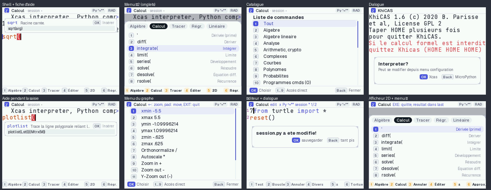

# KhiCAS — Redesign

Refonte complète de l'interface de KhiCAS (calcul formel pour NumWorks sous Upsilon), en gardant
toutes ses fonctionnalités.



## Contenu

| Dossier | Contenu |
|---|---|
| `../apps/KhiCAS/` | L'app modifiée : module d'interface `src/giac-1.6.0/src/kui.{h,cc}`, polices `kfonts.h`, écrans revus dans `kdisplay.cc` / `kadd.cc`, `app.elf` compilé |
| `figma/` | Générateur du design Figma (37 écrans, design system) : plugin Figma + version Scripter |
| `fonctionnalites-khicas.md` | Inventaire de toutes les fonctionnalités de KhiCAS 1.6 |
| `IMPLEMENTATION.md` | Détail de ce qui a changé, phase par phase, et limites connues |
| `tools/` | Génération des polices, simulateur, captures automatiques, build ARM |
| `fonts/` | Geist, JetBrains Mono, STIX Two (SIL Open Font License 1.1) |
| `captures/` | Avant (`avant/`) et après (`apres/`) au simulateur |

## Installer sur la calculatrice

Via l'installeur web de ce dépôt (GitHub Pages) : cocher KhiCAS puis installer. Il utilise
`apps/KhiCAS/app.elf`. Le même fichier est aussi joint à chaque release.

## Recompiler

`tools/` suppose l'arborescence de travail suivante :

```
app/
├── Upsilon-External/   ce dépôt
├── Upsilon/            firmware Upsilon (simulateur Linux), avec tools/upsilon-simulateur.patch appliqué
├── hostdeps/           mpfi compilé pour le PC (simulateur)
└── tools/              le contenu de redesign/tools
```

- `tools/build-arm.sh` : gmp, mpfr, mpfi, MicroPython, giac puis `app.elf` et `apps.tar` pour la calculatrice.
- `tools/sim.sh` puis `tools/run.sh` : simulateur Linux. `tools/shoot.py` rejoue des touches et capture l'écran.

## Crédits

KhiCAS et Giac : Bernard Parisse et al. (GPL 2). Upsilon-External : UpsilonNumworks (MIT, apps sous
leur propre licence). Polices : Geist (Vercel), JetBrains Mono (JetBrains), STIX Two (STI Pub), OFL 1.1.
